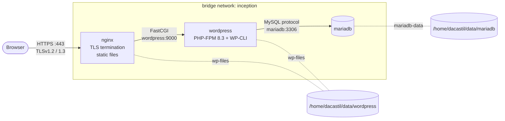

*This project has been created as part of the 42 curriculum by dacastil.*

# Inception


## Description

Three-tier WordPress stack where every service runs in its own container, built from a hand-written
Dockerfile on `alpine:3.19` (no prebuilt service images). Orchestrated with Docker Compose on a
user-defined bridge network. NGINX is the only exposed service; credentials are passed as Compose secrets.



| Container | Listens on | Role | Persistent data |
|---|---|---|---|
| `nginx` | `443` (published) | TLS termination, serves static files, forwards `*.php` over FastCGI | `wp-files` (read) |
| `wordpress` | `9000` (internal) | PHP-FPM pool running WordPress; installs/configures it with WP-CLI | `wp-files` |
| `mariadb` | `3306` (internal) | WordPress database | `mariadb-data` |

## Instructions

### Requirements

- Docker Engine + Compose plugin v2
- GNU Make
- `dacastil.42.fr` resolving to the host (e.g. `127.0.0.1 dacastil.42.fr` in `/etc/hosts`)

### Configuration

`srcs/.env`: non-sensitive configuration only.

```ini
DOMAIN_NAME=dacastil.42.fr
MYSQL_DATABASE=wordpress
MYSQL_USER=pwuser
WP_TITLE=Dani_web
WP_ADMIN_USER=webmaster
WP_ADMIN_EMAIL=admin@dacastil.42.fr
WP_USER=editor
WP_USER_EMAIL=editor@dacastil.42.fr
```

`srcs/secrets/`: one password per file. Git-ignored; never committed.

```sh
mkdir -p srcs/secrets
printf '%s' 'db_password'        > srcs/secrets/db_password.txt
printf '%s' 'db_root_password'   > srcs/secrets/db_root_password.txt
printf '%s' 'wp_admin_password'  > srcs/secrets/wp_admin_passwd.txt
printf '%s' 'wp_user_password'   > srcs/secrets/wp_passwd.txt
```

### Build & run

```sh
make            # create data dirs → build images → compose up -d
```

Site: `https://dacastil.42.fr` · admin: `https://dacastil.42.fr/wp-admin` (self-signed cert, accept the warning).

| Target | Action |
|---|---|
| `make` / `make all` | `mkdir -p` data dirs, `build`, `up` |
| `make build` | `docker compose build` |
| `make up` | `docker compose up -d` |
| `make down` / `make clean` | Stop and remove containers (volumes kept) |
| `make status` | `docker compose ps` |
| `make logs` | `docker compose logs -f` |
| `make fclean` | `docker system prune -a --volumes -f`. **Host-wide**: removes *every* unused image, container, network and volume, not only this project's |
| `make re` | `fclean` + `all` |

## Implementation

### Container boot sequence

Each image's `ENTRYPOINT` is a POSIX `sh` script that performs idempotent first-run initialization and then
`exec`s the daemon in the foreground, so the service runs as **PID 1** and receives `SIGTERM` from `docker stop` directly.
No `tail -f`, `sleep infinity` or other keep-alive hacks.

**mariadb**
1. If `/var/lib/mysql/mysql` does not exist: `mariadb-install-db`, then feed an init script to `mysqld --bootstrap`
   (no network, no running server needed): set root password, create the database, create `MYSQL_USER@'%'`, grant privileges on that database only.
2. Passwords are read from `/run/secrets/*` at runtime; the temporary SQL file is deleted after bootstrap.
3. `exec mysqld --user=mysql --bind-address=0.0.0.0 --port=3306`.

**wordpress**
1. If `wp-config.php` is missing: `wp core download --locale=es_ES`, wait for TCP on `mariadb:3306` (`nc -z`), `wp config create`.
2. Wait until the DB actually answers queries (`wp db check`), since an open port does not mean the server is ready.
3. If `wp core is-installed` fails: `wp core install` (admin user) + `wp user create --role=author` (second user).
4. `chown -R www-data /var/www/html`, then `exec php-fpm83 -F`.

**nginx**
1. If no certificate exists: generate a self-signed RSA-2048 cert with `openssl req -x509 -nodes` (`CN=$DOMAIN_NAME`).
2. `exec nginx -g "daemon off;"`.

Because every step is guarded by a state check, restarts and rebuilds reuse the existing database and site instead of reinstalling.

### Notable configuration

- **NGINX**: `listen 443 ssl` (IPv4 + IPv6), `ssl_protocols TLSv1.2 TLSv1.3`, `ssl_ciphers HIGH:!aNULL:!MD5`,
  `try_files $uri $uri/ /index.php?$args` for WordPress permalinks, `.ht*` denied. Port 80 is not exposed.
- **PHP-FPM**: pool listens on `0.0.0.0:9000` (TCP, since NGINX is in another container and a Unix socket can't be shared without a volume),
  `pm = dynamic` with `max_children = 5`, errors to `stderr` so they show up in `docker logs`. `memory_limit` raised to 512M.
- **WP-CLI** installed as a phar in the image; WordPress itself is downloaded at first start into the volume, not baked into the image.
- **Restart policy** `always` on all services.
- **Admin username** `webmaster`: the subject forbids anything containing *admin*/*administrator*.

### Repository layout

```
.
├── Makefile
└── srcs/
    ├── .env                     # git-ignored
    ├── docker-compose.yml
    ├── secrets/                 # git-ignored
    └── requirements/
        ├── nginx/      Dockerfile · conf/nginx.conf · tools/entrypoint.sh
        ├── wordpress/  Dockerfile · conf/www.conf   · tools/entrypoint.sh
        └── mariadb/    Dockerfile · conf/.conf      · tools/entrypoint.sh
```

See also [`USER_DOC.md`](USER_DOC.md) (operating the stack) and [`DEV_DOC.md`](DEV_DOC.md) (developer setup).

## Design comparisons

### Virtual machines vs Docker

| | Virtual machine | Container |
|---|---|---|
| Kernel | Own guest kernel on a hypervisor | Shares the host kernel |
| Isolation | Hardware virtualization | Namespaces (pid, net, mnt, uts, ipc, user) + cgroups |
| Startup / size | Minutes · GBs | Seconds · MBs |
| Fits | Untrusted multi-tenant workloads, different OS/kernel | One process per service, reproducible builds |

### Secrets vs environment variables

| | Environment variable | Compose secret |
|---|---|---|
| Exposure | Visible in `docker inspect`, `/proc/<pid>/environ`, inherited by every child process | Not in the container config; read from a file only by code that opens it |
| Delivery | Injected into the process environment | Mounted read-only at `/run/secrets/<name>` |
| Used here for | Domain, DB name, usernames, emails | All four passwords |

> Without Swarm, Compose secrets are plain bind-mounted files: they are **not encrypted at rest** and are as safe as
> `srcs/secrets/` on the host. Their value is keeping credentials out of image layers, `docker inspect` and the process environment.

### Docker network vs host network

| | User-defined bridge | `network_mode: host` |
|---|---|---|
| Network stack | Per-container namespace | Shares the host's |
| Service discovery | Embedded DNS: `wordpress`, `mariadb` resolve by service name | None, everything on `localhost` |
| Exposure | Only what is published (`443:443`) | Every listening port is on the host |
| Subject | Required | Forbidden (as are `links` / `--link`) |

### Docker volumes vs bind mounts

| | Named volume | Bind mount |
|---|---|---|
| Managed by | Docker (`docker volume ls/inspect/rm`) | The user, by host path |
| Declared | Top-level `volumes:` with a name | Inline `host_path:container_path` |
| Subject | Required for both persistent stores | Not allowed for them |

Both volumes here are **named volumes** using the `local` driver with `driver_opts: {type: none, o: bind, device: /home/dacastil/data/...}`,
which satisfies the named-volume requirement while placing the data at the path the subject mandates.

## Resources

- [Docker docs](https://docs.docker.com/) · [Compose file reference](https://docs.docker.com/reference/compose-file/) · [Compose secrets](https://docs.docker.com/compose/how-tos/use-secrets/)
- [Dockerfile best practices: ENTRYPOINT & PID 1](https://docs.docker.com/build/building/best-practices/#entrypoint)
- [Docker networking](https://docs.docker.com/engine/network/) · [Docker storage](https://docs.docker.com/engine/storage/)
- [NGINX `ngx_http_ssl_module`](https://nginx.org/en/docs/http/ngx_http_ssl_module.html) · [`ngx_http_fastcgi_module`](https://nginx.org/en/docs/http/ngx_http_fastcgi_module.html)
- [PHP-FPM configuration](https://www.php.net/manual/en/install.fpm.configuration.php)
- [WP-CLI handbook](https://make.wordpress.org/cli/handbook/)
- [MariaDB: `mariadb-install-db`](https://mariadb.com/kb/en/mariadb-install-db/) · [`--bootstrap`](https://mariadb.com/kb/en/mysqld-options/#-bootstrap)
- [Alpine Linux wiki](https://wiki.alpinelinux.org/)

### AI usage

AI assistants (GitHub Copilot / Claude) were used as support tools for:
- Dockerfile syntax and Alpine package selection.
- Refining the MariaDB bootstrap and WordPress installation logic in the entrypoint scripts.
- Initial templates for `nginx.conf` and the PHP-FPM pool configuration.
- Debugging container startup, inter-container networking and secret mounting.
- Drafting and structuring the documentation (README, USER_DOC, DEV_DOC).

All generated code was reviewed, tested and adapted before being committed.
